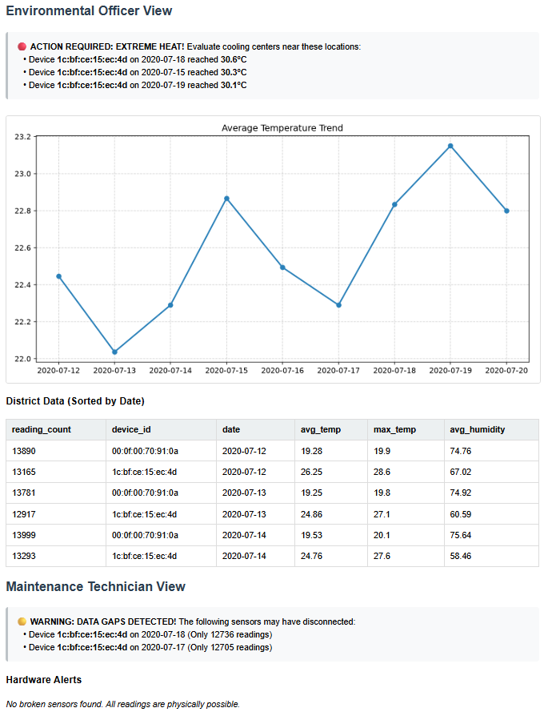

# IoT Environmental Telemetry Data System


## Architecture and Technologies
- **Python 3.11:** Core pipeline logic and orchestration
- **MongoDB:** Document-oriented database for flexible schema evolution
- **Docker:** Containerization for reproducible environments
- **NGINX:** Lightweight web server to host and serve the generated dashboard


## Pipeline Workflow
The system runs through four strictly tracked batch jobs:
1. **Job 1: Ingestion:** Reads raw CSV telemetry data in chunks, converts formats, and loads it into MongoDB while preventing duplicates via unique indexes.
2. **Job 2: Validation:** Scans for physically impossible values (e.g., Humidity > 100%, Temperature < -50°C), isolates them into a sensor alerts collection, and removes them from the raw data pool.
3. **Job 3: Aggregation:** Aggregates raw measurements into daily statistical summaries (average, min, max, reading counts) for each device.
4. **Job 4: Dashboard:** Generates a static HTML dashboard (dashboard.html) and a trend chart, applying business logic to flag data gaps (< 12.750 readings/day) and extreme heat events (> 30.0°C).


## Incident Management

### 1. Day-by-Day Execution
In a production environment, the pipeline is designed to be triggered daily via a scheduler to process the previous day's data. Currently, it runs via Docker Compose. The execution date is currently hard-coded in the variable `CURRENT_EXECUTION_DATE = "2020-07-20"` in `src/config.py`. For the productive environment, change it to `CURRENT_EXECUTION_DATE = datetime.now(timezone.utc).strftime('%Y-%m-%d')` to dynamically process "today's" data.

### 2. Failure Recognition
Every job logs its state (`RUNNING`, `SUCCESS`, `FAILED`) into the MongoDB `batch_executions` collection. 
To check for failures, connect to MongoDB and run:
`db.batch_executions.find({ status: "FAILED" }).sort({ start_time: -1 })`

### 3. Incident Resolution & Restarting
The pipeline uses a "Fail-Fast" mechanism. If Job 2 fails, Jobs 3 and 4 will not execute, preventing data corruption.
- **Identify:** Check the error message in the `batch_executions` document.
- **Fix:** Resolve the underlying issue.
- **Restart:** The system is idempotent. Simply restart the specific failed job or re-run the entire pipeline. Unique indexes in MongoDB prevent data duplication on restart.


## Project Structure
```text
|-- data/
|   |-- iot_telemetry_data.csv               (Raw dataset)
|-- output/
|   |-- dashboard.html                       (Generated report)
|   |-- temperature_trend.png                (Generated chart)
|   |-- example_dashboard_screenshot.png     (Example image)
|-- src/                                     (Modular pipeline components)
|   |-- __init__.py
|   |-- config.py                            (Database connection & settings)
|   |-- job_1_ingestion.py
|   |-- job_2_validation.py
|   |-- job_3_aggregation.py
|   |-- job_4_dashboard.py
|-- docker-compose.yml                       (Infrastructure configuration)
|-- Dockerfile                               (Environment configuration)
|-- requirements.txt                         (Python dependencies)
|-- main.py                                  (Main pipeline execution script)
```


##  How to Run the Project
1. Ensure you have [Docker](https://www.docker.com/products/docker-desktop) installed on your system.
2. Open your terminal, navigate to the project root directory, and run: `docker compose up --build` to build the images and start the database, pipeline, and web server.

Docker will pull the MongoDB image, build the Python environment, connect to the database, and automatically begin batch-processing the CSV file.

### View the Results
Once the terminal outputs `--- Pipeline Execution Finished Successfully ---`, the NGINX web server will host the results.
Open any web browser and navigate to: <http://localhost:8080/dashboard.html>

### Cleanup
The database uses a Docker volume (mongo_data) to persist the data even if the containers stop. If you want to completely wipe the database and start fresh, run: `docker compose down -v`


## Sensor Report Dashboard
The pipeline automatically generates the **Sensor Report Dashboard**. 
This dashboard serves the two primary stakeholders:
- **Environmental Officers:** View historical temperature trends and extreme heat alerts.
- **Maintenance Technicians:** Monitor too few sensor readings (data gaps) and data plausibility warnings.
### Example Sensor Report
